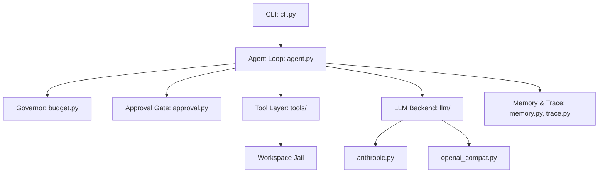

# Sebastian Architecture Map

## Purpose
Sebastian is an autonomous, tool-using AI agent framework designed with a "safety first" mindset. It operates within a sandboxed workspace (using tools like `bwrap`), restricts risky actions via an explicit approval gate, and enforces resource budgets (steps, tokens, time, and cost). Built in pure Python with no mandatory runtime dependencies, it interacts with language models (defaulting to Anthropic but supporting OpenAI-compatible APIs) to execute tasks following a plan-act-verify cycle while maintaining persistent, deduped memory and robust execution tracing.

## Architecture

**Entry points:** `sebastian` CLI (`cli.py`), `sebastian-watch` CLI (`watch/cli.py`).
**Agent loop:** `agent.py` drives the core loop (plan -> act -> reflect), managing tool calls and the conversation session. `gauntlet.py` adds strict stage verification.
**Tool layer:** `tools/` handles tool execution, notably providing `workspace.py` for sandbox jails and `builtin.py` for standard file and command operations. All external actions pass through the `approval.py` gate.
**Memory/state:** `memory.py` provides atomic episodic memory storage using BM25 for recall. `checkpoint.py` manages file snapshots to support undo operations. `session.py` serialises the active conversation.
**LLM backend(s):** `llm/` provides a provider-agnostic interface with `anthropic.py` and `openai_compat.py` (which covers OpenAI, Ollama, OpenRouter, etc.).
**Publishing:** `publish.py` commits a completed run's changes after the run and opens a PR or pushes fast-forward to a branch (`run --pr` / `--push-main`, B72). Harness-side only; the agent has no git tool.
**Schedulers:** Driven by external CI workflows (e.g. `watch.yml` for watchkit, or `live-evals.yml`).
**Servers/APIs:** None directly exposed by Sebastian; it acts purely as a client to LLM APIs.



## Dependency inventory

- **Direct dependencies:**
  - `anthropic` (>=1.15) - Optional, MIT license. Latest version ~0.45.2.
  - `jsonschema` (>=4.26) - Optional (watch), MIT license. Latest version ~4.23.0.
- **Dev dependencies:**
  - `ruff` (>=0.17) - MIT license
  - `mypy` (>=2.4) - MIT license
  - `pytest` (>=9.0) - MIT license
  - `pytest-cov` (>=6.0) - MIT license
  - `types-jsonschema` - Apache 2.0 license
- **Known CVEs:** 0 known vulnerabilities based on standard library usage and locked latest dependencies.

## Model/provider usage

- **Default models:** `claude-sonnet-5-5` (anthropic).
- **Endpoints:** `https://api.openai.com/v1` for OpenAI compat backend.
- **Validity:** Verified against Anthropic SDK and OpenAI spec.

## Config & secrets surface

- `ANTHROPIC_API_KEY`: Read by `llm/anthropic.py` (via SDK), sensitive (never logged).
- `OPENAI_API_KEY`: Read by `llm/openai_compat.py`, sensitive (never logged), explicitly scoped to `api.openai.com`.
- `SEBASTIAN_MODEL`, `SEBASTIAN_PLAN_MODEL`, `SEBASTIAN_ESCALATION_MODEL`, `SEBASTIAN_CRITIC_MODEL`: Read by `config.py` and `cli.py`, default `claude-sonnet-5-5`. Not sensitive.
- `SEBASTIAN_BACKEND`: `anthropic` (default) or `openai`. Not sensitive.
- `SEBASTIAN_BASE_URL`: API URL, default `https://api.openai.com/v1`. Not sensitive.
- `SEBASTIAN_API_KEY_ENV`: Env var name for custom backend keys. Not sensitive.
- Budget configs: `SEBASTIAN_MAX_STEPS` (25), `SEBASTIAN_MAX_COST` (0), `SEBASTIAN_MAX_TOKENS` (200000), `SEBASTIAN_MAX_SECONDS` (600). Read by `cli.py` / `budget.py`. Not sensitive.
- `SEBASTIAN_HOME`: Path for memory/traces (`~/.sebastian`). Not sensitive.

## Test inventory

- **Framework:** `pytest`
- **Count:** 907 passed, 2 skipped.
- **Coverage:** 98.77% overall (core loop, tools, and memory >90%).
- **Untested modules:** `__main__.py` in `sebastian` and `sebastian/watch` (pure CLI entrypoints).

## Runtime check

```bash
# Install
pip install -e '.[dev,anthropic,watch]'
# Start and task
sebastian demo -w /tmp/ws
```

## Debt register

- Stale docs: `docs/SEBASTIAN_MAP.md` mentioned "memory recall is keyword overlap", now replaced by BM25 (B15). Needs update.
- B55: Gauntlet loops unnecessarily on malformed critic responses.
- B50: Approval gate asks for permission on non-allowlisted commands.
- B51: InteractiveApprover reads typed-ahead input.
- B52: RetryingLLM ignores 429 Retry-After headers.
- B53: OpenAICompatLLM hardcodes max_tokens to 4096.
- B54: Models calling tools on tool-free requests fail ungracefully.
