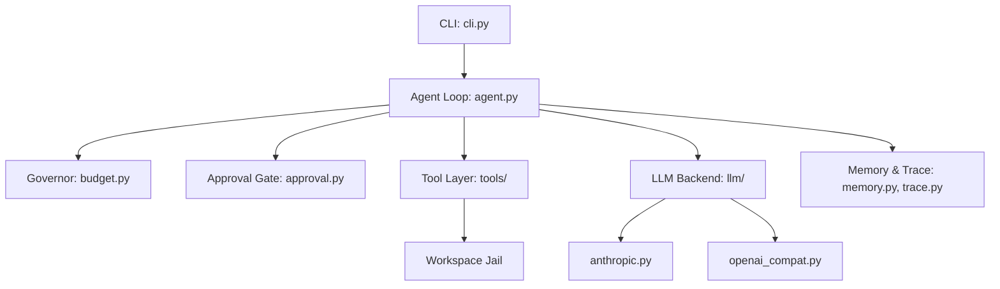

# Sebastian Architecture Map

## Purpose
Sebastian is an autonomous, tool-using AI agent framework designed with a "safety first" mindset. It operates within a sandboxed workspace (using tools like `bwrap`), restricts risky actions via an explicit approval gate, and enforces resource budgets (steps, tokens, time, and cost). Built in pure Python with no mandatory runtime dependencies, it interacts with language models (defaulting to Anthropic but supporting OpenAI-compatible APIs) to execute tasks following a plan-act-verify cycle while maintaining persistent, deduped memory and robust execution tracing.

## Architecture

**Entry points:** `sebastian` CLI (`cli.py`), `sebastian-watch` CLI (`watch/cli.py`).
**Agent loop:** `agent.py` drives the core loop (plan -> act -> reflect), managing tool calls and the conversation session. `gauntlet.py` adds strict stage verification. Its pure contracts live in `gauntlet_core.py` (stdlib-only, hash-pinned, vendored byte-identical into LESTINXOR-AGENT as `lestinxor/gauntlet_core.py`).
**Tool layer:** `tools/` handles tool execution, notably providing `workspace.py` for sandbox jails and `builtin.py` for standard file and command operations. All external actions pass through the `approval.py` gate.
**Memory/state:** `memory.py` provides atomic episodic memory storage using BM25 for recall. `checkpoint.py` manages file snapshots to support undo operations; `rundiff.py` (`sebastian diff`, B56) reads them to show a run's changes as a unified diff. `costs.py` (`sebastian cost`, B58) totals tokens and spend per model per day from the trace file. `session.py` serialises the active conversation.
**LLM backend(s):** `llm/` provides a provider-agnostic interface with `anthropic.py` and `openai_compat.py` (which covers OpenAI, Ollama, OpenRouter, etc.).
**Trust ladder:** `trust.py` derives an autonomy level (L0 suggest, L1 draft-pr, L2 pr) from `history.jsonl`: live eval and red-team rounds, plus evolve PRs that merged or were reverted, which `prledger.py` records from `$SEBASTIAN_HOME/prs.jsonl` (`sebastian trust --sync`, B26b). `evolve` enforces it (B26c): L0 keeps an accepted branch local, L1 opens a draft PR, L2 a ready one.
**Publishing:** `publish.py` commits a completed run's changes after the run and opens a PR or pushes fast-forward to a branch (`run --pr` / `--push-main`, B72). Harness-side only; the agent has no git tool.
**Cross-testing:** `crosstest.py` (`sebastian crosstest`) runs each agent's suite from an owner manifest against every listed agent in throw-away workspaces and prints a pass matrix. It is read-only towards every repo; see `docs/CROSSTEST.md`.
**Schedulers:** Driven by external CI workflows (e.g. `watch.yml` for watchkit, or `live-evals.yml`).
**Servers/APIs:** None directly exposed by Sebastian; it acts purely as a client to LLM APIs.

## Dependency inventory

- **Direct dependencies:**
  - `anthropic` (>=1.15) - Optional, MIT license. Latest version 2.4.0.
  - `jsonschema` (>=4.26) - Optional (watch), MIT license. Latest version 4.26.0.
- **Dev dependencies:**
  - `ruff` (>=0.17,<0.18) - MIT license
  - `mypy` (>=2.4) - MIT license
  - `pytest` (>=9.0) - MIT license
  - `pytest-cov` (>=6.0) - MIT license
  - `types-jsonschema` - Apache 2.0 license
- **Known CVEs:** 0 known vulnerabilities based on standard library usage and locked latest dependencies.

## Model/provider usage

- **Default models:** `claude-sonnet-5-5` (anthropic).
- **Endpoints:** `https://api.openai.com/v1` for OpenAI compat backend.
- **Validity:** Verified against Anthropic SDK and OpenAI spec.

## Config & secrets surface

- `ANTHROPIC_API_KEY`: Read by `llm/anthropic.py` (via SDK), sensitive (never logged).
- `OPENAI_API_KEY`: Read by `llm/openai_compat.py`, sensitive (never logged), explicitly scoped to `api.openai.com`.
- `SEBASTIAN_MODEL`, `SEBASTIAN_PLAN_MODEL`, `SEBASTIAN_ESCALATION_MODEL`, `SEBASTIAN_CRITIC_MODEL`: Read by `config.py` and `cli.py`, default `claude-sonnet-5-5`. Not sensitive.
- `SEBASTIAN_BACKEND`: `anthropic` (default) or `openai`. Not sensitive.
- `SEBASTIAN_BASE_URL`: API URL, default `https://api.openai.com/v1`. Not sensitive.
- `SEBASTIAN_API_KEY_ENV`: Env var name for custom backend keys. Not sensitive.
- Budget configs: `SEBASTIAN_MAX_STEPS` (25), `SEBASTIAN_MAX_COST` (0.0), `SEBASTIAN_MAX_TOKENS` (200000), `SEBASTIAN_MAX_SECONDS` (600), `SEBASTIAN_MAX_OUTPUT_TOKENS` (4096). Read by `cli.py` / `config.py` / `budget.py`. Not sensitive.
- `SEBASTIAN_HOME`: Path for memory/traces (`~/.sebastian`). Not sensitive.

## Test inventory

- **Framework:** `pytest`
- **Count:** 1148 passed, 2 skipped.
- **Coverage:** 98.92% overall.
- **Untested modules:** `__main__.py` in `sebastian` and `sebastian/watch` (pure CLI entrypoints).

## Runtime check

- **Install:** `uv venv && source .venv/bin/activate && uv pip install -e '.[dev,anthropic,watch]'`
- **Start:** `sebastian demo -w /tmp/ws` (creates a temporary workspace and runs tests)
- **Baseline Test:** `PYTHONPATH=src python -m pytest --cov`
- **Baseline Commit Hash:** 098dc29c2fba8f77c2eeab168d803d14a2cb7391

## Debt register

Re-checked against the code on 2026-11-01 (main `70a1836`, B61). Each line cites where the debt
lives; the matching backlog item is the fix. Removed as resolved: stale "keyword overlap" recall
note (memory uses BM25, see Architecture), B52 (`llm/base.py:38` `parse_retry_after`), B53
(`llm/openai_compat.py:149`, `max_tokens` is configurable).

- B50: the allowlist is checked inside `run_command` (`tools/builtin.py:259`), after the approval
  gate has already asked the human (`approval.py:146`), so un-runnable commands get prompts.
- B51: `InteractiveApprover.approve` reads the answer with plain `input()` (`approval.py:156`);
  nothing in `src/` flushes typed-ahead input.
- B54: tool-free calls omit `tools` (`llm/openai_compat.py:221`), but a provider 400
  `tool_use_failed` is not handled anywhere in `src/`, so such models die at step 0.
- B55: the critic is asked once (`agent.py:447`); a malformed verdict is a FAIL
  (`gauntlet_core.py:221-232`) and costs a whole ACT loop instead of one format re-ask.
- B67: the jail blocks only path components named `.git` (`tools/workspace.py:33-34`), so a repo
  skeleton (`HEAD`, `config`, `objects/`, `refs/`) can be written under any other name.
- B68: `watch/gitio.py:36-41` runs git without the hardening evolve applies (`GIT_CONFIG_NOSYSTEM`,
  `core.fsmonitor=`, `core.hooksPath=/dev/null`).
- B70, B71 (missing capability, not a defect): no `apply_patch` or `fetch_url` tool in
  `tools/builtin.py`; multi-hunk edits need one approval per `edit_file`.
- TODOs: `src/sebastian/evals/cases.py` contains unused TODOs.

## UniSync (added 2026-10-31)

`src/sebastian/unisync.py` reports finished `run`/`resume`/`evolve` commands to the shared UNISYNCARC ledger (Supabase, `unisync_events`) that all of Jonny's agents share; `sebastian unisync ping|escalate` posts directly. Stdlib only, opt-in via `UNISYNC_SUPABASE_URL`/`UNISYNC_SUPABASE_KEY`. Protocol spec: LESTINXOR-AGENT `docs/UNISYNC.md`.

`src/sebastian/langfuse.py` (B79) sends a finished `run`/`resume`/`demo` to Langfuse as one OTLP/JSON span when `--langfuse` is given, and returns the trace link that `cli.py` writes as `trace_url` into the `--usage-out` file for Bastion. Stdlib only; keys from `LANGFUSE_PUBLIC_KEY`/`LANGFUSE_SECRET_KEY`.
