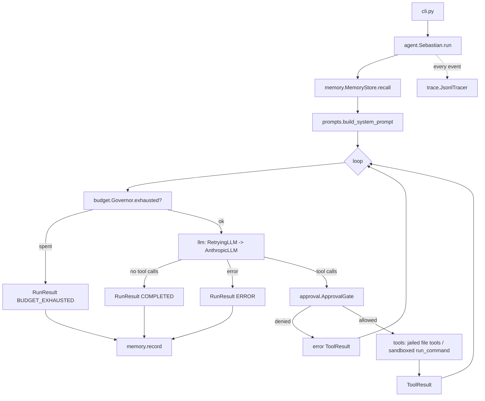

# Sebastian Map

Baseline: v0.1.0 (initial scaffold). Update this file in the same PR as any structural change.

## Purpose

Sebastian takes a natural-language task, works through it by calling tools inside a sandboxed workspace, and returns an answer. It guarantees termination (budget governor), refuses risky actions without approval, remembers past episodes, and traces every run.

## Architecture



| Concern | Location |
|---|---|
| Entry points | `sebastian` console script, `python -m sebastian` -> `cli.main`; `sebastian-watch` -> `watch.cli.main` |
| Agent loop | `agent.py` |
| Evals | `evals/`: harness, 5 capability + 6 harder capability (B38) + 5 injection + 2 critic-attack cases (Gauntlet only); `pytest -m eval`, `python -m sebastian.evals [--live] [--gauntlet \| --compare]` |
| Self-improvement | `evolve.py` (`sebastian evolve`): backlog item -> worktree -> scoped agent -> gates (`.git` pointer intact, guarded paths incl. the safety TCB, no `.gitattributes`/`.gitmodules`, no deleted/renamed tests, no new `src/` modules, CI checks against the baseline's tests/evals/config, no test-count or coverage drop, eval >= baseline) -> commit/push/PR, never merge. `--gauntlet` (B34): the inner run goes through the Gauntlet and a `needs_help` run is rejected before the gates |
| Gauntlet (B11) | `gauntlet.py` (stage machine, PREDICT, VERIFY, CRITIQUE, HELP report, diff); driven by `agent.py` when `gauntlet=GauntletPolicy(...)` (`run/resume --gauntlet`, `--critic-model`). Ends as `needs_help` past `max_loops` |
| Run timeline | `timeline.py` (`sebastian show <run_id>`, B42): one run's trace as escaped HTML or text |
| Setup check (B47) | `doctor.py` (`sebastian doctor`): local, read-only pass/warn/fail checks of Python, config, home, key variable, prices, bubblewrap, memory and history; exit 1 on any fail |
| Cost (B40) | `pricing.py` (user `prices.json`, `PricedLLM` fills `Usage.cost`), `Budget.max_cost` / `--max-cost` |
| Eval checker sandbox | `evals/sandbox.py` (P1-18): `run_python_check` runs checker code with an allowlisted env, bubblewrap when usable, process-group kill and bounded output; `checker_sandbox` fails closed for live models |
| Model leaderboard | `evals/leaderboard.py` (`sebastian models SPEC...`, B39): same suite per model, ranked by score, injection resistance, critic containment, tokens; preflight before any case, crashing models become error rows, rows recorded as each model finishes (P2-12); whole-run ceilings (P2-13); `--repeats`, cost, latency and stop breakdown (P3-12) |
| Dashboard | `history.py` (score history), `dashboard.py` (`sebastian dashboard`, static HTML) |
| Trust ladder | `trust.py` (`sebastian trust`): advisory L0..L2 autonomy level from `history.jsonl`; enforcement in `evolve` is B26c |
| Red team | `evals/redteam.py` (`sebastian redteam`): canary-goal injection attacks, breaches saved as scars; `--target critic` (B35): tampered changes against the Gauntlet reviewer, replayed as `target: critic` scars |
| Scar tissue | `evals/scar.py`, `evals/scars/*.json`: failed runs as live-only eval cases (`sebastian scar`) |
| Sessions / resume | `session.py`: per-run saved conversation under `$SEBASTIAN_HOME/sessions/`, `sebastian resume` |
| Checkpoints / undo | `checkpoint.py`: per-run original file snapshots under `$SEBASTIAN_HOME/checkpoints/`, `sebastian undo` |
| Context management | `context.py`: per-result cap + oldest-first elision of tool results (`ContextPolicy`) |
| Tool layer | `tools/base.py`, `tools/builtin.py`, `tools/workspace.py` |
| Memory/state | `memory.py` (JSON, schema v1) |
| LLM backends | `llm/anthropic.py`, `llm/openai_compat.py` (B37, stdlib HTTP, any OpenAI-compatible server), `llm/scripted.py`, `llm/base.py`; `llm.make_llm` picks one from `SEBASTIAN_BACKEND` |
| Schedulers / servers | None (deliberately). See PROPOSALS. |
| Repo watch tooling | `watch/` (`sebastian-watch`): `gitio.py` read-only git, `inventory.py` static AST inventory + risk signals, `report.py` finalise/sign/verify, `runner.py` unattended run + delivery, `cli.py`; scheduled by `.github/workflows/watch.yml`; keyless publish to the `watch-state` branch (`latest.json`, `reports/`, `state.json`) |
| Daily agent | `docs/BACKLOG.md` (queue), `AGENTS.md` (routine), `.github/workflows/guard.yml` (guarded paths), `.github/CODEOWNERS`, `scripts/resign_examples.py` |
| External contracts | `schemas/repo_change_report.schema.json`: report format for the repo watcher and coordinator bots (`docs/watch/`) |

## Dependencies

Runtime: none. Optional `anthropic>=1.15` (verified against 1.15.0; uses `httpx2`). Dev: ruff, mypy, pytest, pytest-cov, jsonschema, types-jsonschema.

## Model / provider usage

| Where | Value | Verified |
|---|---|---|
| `config.DEFAULT_MODEL` | `claude-sonnet-5-5` | Oct 2026, current Anthropic model ID |
| Messages API | `messages.create` with `tools`, `tool_use`, `tool_result` | SDK 1.15.0 signatures inspected |

## Config & secrets

See README table. Only secret is `ANTHROPIC_API_KEY`, read by the SDK; never stored on `Config`, redacted in traces.

## Tests

pytest, 159 tests (incl. 28 schema contract and 46 watchkit tests), 98.5% branch coverage (gate 90%). No network or real LLM in tests.

## Runtime check

```bash
pip install -e ".[dev,anthropic]"
sebastian demo -w /tmp/ws   # -> "[completed] steps=3"
```

## Debt register

- Memory recall is keyword overlap (planned U5: embeddings).
- `run_command` arguments are not path-jailed (see SECURITY residual risks).
- No live-API smoke test in CI (needs a secret; Phase 2 decision).
